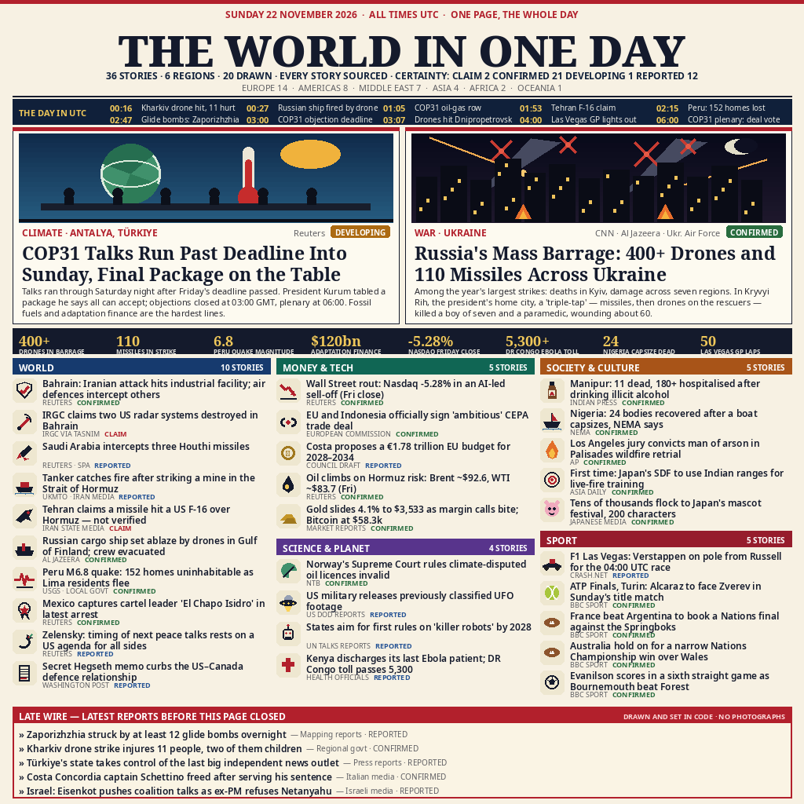

# The World in One Day — Sunday 22 November 2026

One front page that sums up the world's news of **Sunday 22 November 2026**:
**36 stories · 6 regions · 20 drawn in code** — every story sourced, every
unconfirmed claim flagged with a certainty tag (CONFIRMED / REPORTED /
DEVELOPING / CLAIM), a UTC timeline of the day, a by-the-numbers band and a
late-wire strip.

## What's on the page

- **Heroes:** COP31 in Antalya running past its deadline into Sunday with a
  final package on the table (Reuters, DEVELOPING), and Russia's mass barrage
  on Ukraine — 400+ drones and 110 missiles, including the Kryvyi Rih
  "triple-tap" (CNN · Al Jazeera, CONFIRMED).
- **Sections:** World (10), Money & Tech (5), Science & Planet (4),
  Society & Culture (5), Sport (5), plus a 5-item Late Wire.
- **Accounting on the masthead:** story, region and certainty counts are
  computed from the story database and printed on the page itself.

## How it works

- `stories.py` — the story database: every item reported on 22 Nov 2026,
  with outlet, certainty tag, region and icon, plus the UTC timeline and
  the by-the-numbers band.
- `art.py` — flat vector-style illustrations drawn in code with PIL: two
  hero scenes (Antalya globe-and-thermometer; night barrage over a skyline)
  and spot icons for the cards. No photographs, no stock.
- `build.py` — the deterministic renderer: `python3 build.py` writes
  `entry.png` (1024×1024 PNG, under the 1 MiB cap). No clock, no network,
  no randomness — two runs produce the same bytes.
- `main.py` — the entrypoint (Python 3.13, standard library only): copies
  `entry.png` to `/output/entry.png`, validating the format, the 1 MiB cap
  and the 1024×1024 cap on the way.

## Entry for

make.fun bounty [news-image-20261122](https://make.fun/bounty/news-image-20261122)
— "Sum up 22 November's world news in one image".

## License

MIT — see `LICENSE` (SPDX-License-Identifier: MIT).
